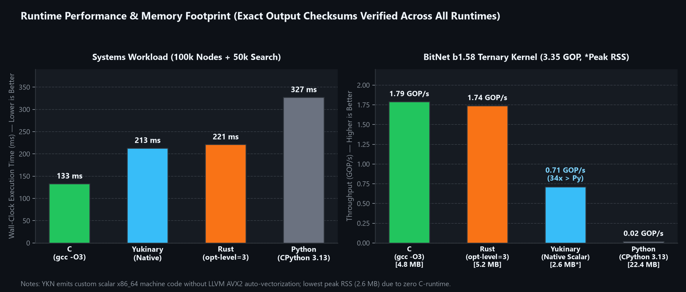

<div align="center">

<p align="center">
  <a href="README.md">English</a> |
  <a href="README.tr.md">Türkçe</a> |
  <a href="README.ru.md">Русский</a> |
  <a href="README.ja.md">日本語</a> |
  <a href="README.zh-CN.md">简体中文</a> |
  <a href="README.ko.md">한국어</a> |
  <b>Français</b>
</p>


# Langage de programmation Yukinary (YKN)

**Compilateur x86_64 self-hosting • Génération directe de code PE32+ et ELF64 (sans LLVM / sans runtime C) • Syntaxe multilingue • Auto-réparation expérimentale et IA embarquée**

[](LICENSE-MIT)
[](LICENSE-APACHE)
[](https://github.com/ykncode/yukinary/releases)
[](https://github.com/ykncode/yukinary/releases)
[](https://github.com/ykncode/yukinary)
[](https://github.com/ykncode/benchmarks)

<p align="center">
  <a href="#benchmarks-et-performances-vs-c-rust-go-python">Benchmarks</a> •
  <a href="#démarrage-rapide-et-versions">Téléchargement et démarrage rapide</a> •
  <a href="#documentation-du-langage">Documentation</a> •
  <a href="#architecture-micro-llm-vs-llm-complet">Couche IA (expérimentale)</a> •
  <a href="#fonctionnalités-clés">Architecture</a> •
  <a href="#développement-de-systèmes-dexploitation--larchitecture-yknos">YknOS</a> •
  <a href="#maturité-pour-la-production-limites-honnêtes-et-garanties">Limites honnêtes</a> •
  <a href="#écosystème-à-quatre-dépôts">Écosystème</a>
</p>

---

</div>

## Présentation

**Yukinary (YKN)** est un langage de programmation système indépendant et self-hosting, doté d'un compilateur natif. Au lieu de cibler LLVM IR ou de transpiler vers C, Yukinary abaisse directement son AST en **code machine x86_64** autonome, en écrivant à partir de zéro les en-têtes binaires PE32+ (Windows) et ELF64 (Linux), les syscalls et les opcodes, avec **aucune dépendance d'exécution externe** (`libc`, `msvcrt` ou éditeurs de liens externes).

* **Self-hosting bit à bit identique :** le compilateur (écrit en Yukinary) se compile lui-même de façon déterministe (`Stage 2 SHA-256 == Stage 3 SHA-256`).
* **Syntaxe multilingue canonique et pédagogique :** les mots-clés peuvent être écrits en anglais, turc, russe, japonais, chinois simplifié, coréen ou français ; conçue pour l'enseignement localisé de la programmation, `ykn fmt` gère actuellement la mise en forme, tandis que la traduction canonique des mots-clés et des commentaires est prévue dans un futur outillage.
* **Cible systèmes freestanding et OS :** propulse l'espace utilisateur d'un OS expérimental basé sur Linux ([`examples/yknos`](examples/yknos)).

---

## Benchmarks et performances (vs. C, Rust, Go, Python)

L'ensemble des harnais de benchmark, des implémentations concurrentes en C/Rust/Python et des télémétries JSON brutes est publié dans notre dépôt de benchmarks dédié :  
[**Suite de benchmarks officielle : `github.com/ykncode/benchmarks`**](https://github.com/ykncode/benchmarks) • [**Rapport de benchmark industriel (TR)**](https://github.com/ykncode/benchmarks/blob/main/industrial/YUKINARY_ENDUSTRIYEL_BENCHMARK_RAPORU.md)

<div align="center">
  
</div>

<div align="center">
  
</div>

### Synthèse des résultats mesurés (`ykncode/benchmarks`)

| Benchmark | Yukinary (`ykn`) | C (`gcc -O3`) | Rust (`rustc -O3`) | Python (`3.13`) | Remarques |
| :--- | :---: | :---: | :---: | :---: | :--- |
| **Temps de compilation** (`optimizer`) | **18.6 ms** | 219.4 ms | 272.2 ms | — | Aucun surcoût LLVM/éditeur de liens (**compilations 11x–31x plus rapides**) |
| **B-Tree système** (100k nœuds, 50k recherches) | **213 ms** | 133 ms | 221 ms | 327 ms | Somme de contrôle exacte vérifiée (`19526` / `6363996222`) |
| **BitNet b1.58** (noyau ternaire de 3.35 GOP) | **0.71 GOP/s** | 1.79 GOP/s | 1.74 GOP/s | 0.02 GOP/s | Codegen natif scalaire (GCC/Rust utilisent l'AVX2 de LLVM/GCC) |
| **Mémoire maximale (RSS BitNet)** | **2.6 MB** | 4.8 MB | 5.2 MB | 22.4 MB | **Empreinte la plus faible** (freestanding, sans libc) |
| **Latence de démarrage à froid** | **5.4 ms** | 5.9 ms | 6.8 ms | 35.0 ms | Point d'entrée OS direct (`ExitProcess` / `sys_exit`) |

> **Note d'ingénierie :** C (`gcc -O3`) et Rust (`rustc -O3`) restent environ 2.5x plus rapides sur l'arithmétique matricielle dense grâce à l'auto-vectorisation de GCC/LLVM (SIMD AVX2). Yukinary s'appuie sur un encodeur x86_64 scalaire maison avec allocation de registres par balayage linéaire (linear-scan), en privilégiant une compilation instantanée, une empreinte réduite sans libc et l'absence de toute dépendance à une chaîne d'outils externe. Parcourez toutes les charges de travail sources dans [**`ykncode/benchmarks`**](https://github.com/ykncode/benchmarks).

---

## Démarrage rapide et versions

Vous **n'avez pas besoin** d'un compilateur C++ ni d'une chaîne d'outils externe pour exécuter Yukinary. Des binaires natifs autonomes sont disponibles dans les Releases :

### 1. Téléchargement et installation
[**Télécharger Yukinary depuis les GitHub Releases**](https://github.com/ykncode/yukinary/releases)

#### Windows (installation en 1 clic)
1. Téléchargez **`yukinary-setup-windows-x86_64.zip`** depuis les Releases et extrayez-le.
2. Double-cliquez sur **`setup.cmd`** (ou exécutez `powershell -ExecutionPolicy Bypass -File setup.ps1`).

#### Linux et macOS (installation en 1 ligne)
1. Téléchargez **`yukinary-setup-linux-x86_64.tar.gz`** et extrayez-le (`tar -xzf yukinary-setup-linux-x86_64.tar.gz`).
2. Exécutez **`./setup.sh`**.

#### Extension Visual Studio Code (`.vsix`)
```bash
code --install-extension yukinary-lang-1.0.0.vsix
```

### 2. Écrire et compiler votre premier programme (`hello.ykn`)
```ykn
# English syntax (canonical keywords; native stdio intrinsic: ekrana_yaz)
fn main() -> i64 {
    ekrana_yaz("Hello, Yukinary!\n".ptr);
    return 0;
}
```

Compilez directement en code machine natif Windows PE32+ ou Linux ELF64 :
```powershell
# Windows PE32+
ykn hello.ykn hello.exe
.\hello.exe

# Compilation croisée Linux ELF64 depuis Windows ou Linux natif
ykn --target linux hello.ykn hello
```

---

## Documentation du langage

Les guides du développeur et les références de syntaxe sont disponibles dans les langues prises en charge :

| Langue | Fichier | Description |
| :--- | :--- | :--- |
| **English** | [**`docs/guide_en.md`**](docs/guide_en.md) | Developer Guide, Syntax Reference, `#convert` Engine, Architecture, and Tooling |
| **Türkçe** | [**`docs/kullanim_rehberi_tr.md`**](docs/kullanim_rehberi_tr.md) | Türkçe Kullanım Kılavuzu, sözdizimi, `#convert`, Micro-LLM ve FFI motoru |
| **Русский** | [**`docs/guide_ru.md`**](docs/guide_ru.md) | Руководство разработчика, многоязычный синтаксис, `#convert` и архитектура |
| **日本語** | [**`docs/guide_ja.md`**](docs/guide_ja.md) | 開発者ガイド、日本語ネイティブ構文、`#convert`変換、自己修復機能 |
| **简体中文** | [**`docs/guide_zh.md`**](docs/guide_zh.md) | 开发者完全指南、原生中文语法、`#convert`多语言转译与嵌入式 AI |
| **한국어** | [**`docs/guide_ko.md`**](docs/guide_ko.md) | 개발자 가이드, 한국어 네이티브 문법, `#convert` 변환 엔진 및 메모리 안전성 |

> [!TIP]
> **Note de conception sur la localisation :** les mots-clés multilingues reposent sur des correspondances dynamiques de tokens dans le lexer (`docs/Multi-lingual-add-language.md`) afin d'abaisser la barrière d'entrée pour les étudiants et les non-anglophones. Pour les paquets open source collaboratifs, l'anglais est recommandé comme standard canonique.

---

## Architecture Micro-LLM vs. LLM complet

Yukinary intègre un outillage neuronal expérimental dans le pipeline de compilation au moyen de **deux couches distinctes** :

```text
┌────────────────────────────────────────────────────────────────────────┐
│                      YUKINARY AI ENGINE ARCHITECTURE                   │
└────────────────────────────────────────────────────────────────────────┘
                                    │
         ┌──────────────────────────┴──────────────────────────┐
         ▼                                                     ▼
┌───────────────────────────────────┐       ┌───────────────────────────────────┐
│     1. EMBEDDED MICRO-LLM         │       │       2. EXTERNAL FULL LLM        │
│          (Always-On)              │       │          (On-Demand)              │
├───────────────────────────────────┤       ├───────────────────────────────────┤
│ * std/ai/micro_llm.ykn            │       │ * src/llm.ykn                     │
│ * std/ai/embedded_weights.ykn     │       │ * std/ai/gguf_loader.ykn          │
│ • Size: 16,448 Bytes (~16 KB)     │       │ • Size: 1 GB – 40 GB GGUF v3      │
│ • Baked into binary (.rodata)     │       │ • Loaded dynamically from disk    │
│ • Zero files, zero internet,      │       │ • CLI: `--llm-model model.gguf`   │
│   zero external dependencies      │       │ • Polyglot `#convert` Engine      │
│ • Sub-millisecond latency (<1ms)  │       │   (Deep semantic library trans-   │
│ • Purpose: Compiler Reflexes,     │       │   pilation: C/C++/Python/Rust)    │
│   Self-Healing, LSP Autocomplete, │       │ • Natural language `#prompt "..."`│
│   Offline signature fallback      │       │   algorithmic code synthesis      │
└───────────────────────────────────┘       └───────────────────────────────────┘
```

### Comparaison architecturale et rôles opérationnels

| Dimension | Micro-LLM embarqué (16 KB) | LLM complet externe (1B – 70B GGUF) |
| :--- | :--- | :--- |
| **Emplacement et stockage** | Intégré directement dans le binaire du compilateur (section `.rodata`) | Fichier `.gguf` externe chargé dynamiquement depuis le stockage de l'utilisateur |
| **Taille et poids** | Poids BitNet ternaires `{-1, 0, +1}` de **16,448 octets (~16 KB)** | **1 GB – 40 GB** (BitNet b1.58, Llama-3, Mistral, Qwen, etc.) |
| **Matériel requis** | **Aucun GPU, aucun Python, aucune connexion Internet.** Fonctionne sur tout CPU 64 bits grâce à l'arithmétique en virgule fixe Q16.16 | Nécessite 4 GB – 32 GB de RAM / VRAM selon la quantification et la taille du contexte |
| **Latence d'inférence** | **Inférieure à la milliseconde (< 1 ms)** — surcoût minimal à la compilation | 10 – 50 millisecondes par token |
| **Périmètre principal** | **Réflexes et outillage du compilateur :**<br>• Réparation de la syntaxe et des fautes de frappe (`--self-heal` : points-virgules, parenthèses)<br>• Injection défensive de `null-guard` contre les plantages<br>• Autocomplétion LSP en temps réel des champs de struct et des tokens<br>• Repli hors ligne léger pour les mots-clés et signatures | **Outillage génératif expérimental :**<br>• **`#convert` polyglotte :** aide à la traduction d'extraits C, Python et Rust en YKN<br>• Directives de prompt en langage naturel (`#prompt "..."`) |
| **Mode d'activation** | **Toujours actif** (aucun modèle externe requis) | **Sur activation** via `--llm-model <path.gguf>` |

### Télécharger et utiliser les modèles LLM complets (BitNet et Bonsai)

Yukinary compile du code d'emblée avec **aucun téléchargement de modèle**. Pour tester les workflows lourds `#prompt` ou `#convert`, vous pouvez indiquer au compilateur des modèles GGUF standard hébergés sur [Hugging Face](https://huggingface.co).

#### 1. Téléchargement en une commande
```powershell
# Windows (PowerShell)
powershell -File tools/download_models.ps1 bitnet    # Microsoft BitNet b1.58 (1.18 GB)
powershell -File tools/download_models.ps1 bonsai    # Prism ML Bonsai 8B (1.15 GB)
powershell -File tools/download_models.ps1 all
```

```bash
# Linux / macOS (Bash)
sh tools/download_models.sh bitnet
sh tools/download_models.sh bonsai
sh tools/download_models.sh all
```

#### 2. Téléchargement manuel (liens directs Hugging Face)

| Modèle | Taille | Format | Lien de téléchargement direct | Chemin local cible |
| :--- | :--- | :--- | :--- | :--- |
| **Microsoft BitNet b1.58 2B4T** | 1.18 GB | GGUF (i2_s) | [Télécharger depuis Hugging Face](https://huggingface.co/microsoft/bitnet-b1.58-2B-4T-gguf/resolve/main/ggml-model-i2_s.gguf) | `models/bitnet-b1.58-2B-4T/ggml-model-i2_s.gguf` |
| **Prism ML Bonsai 8B** | 1.15 GB | GGUF | [Télécharger depuis Hugging Face](https://huggingface.co/prism-ml/Bonsai-8B-gguf/resolve/main/Bonsai-8B.gguf) | `models/bonsai-8b/Bonsai-8B.gguf` |

#### 3. Utiliser les modèles avec le compilateur

##### Méthode A : directive `#config` dans le code source
```ykn
#config {
    model: "bitnet",          # Loads 'models/bitnet-b1.58-2B-4T/ggml-model-i2_s.gguf'
    optimizasyon: 3,          # Enable O3 loop and register optimization
    yigin_boyutu: 16777216,   # 16 MB stack size stamped into binary headers
    guvenli: true             # Enable compile-time bounds checking
}

#PY-convert
def multiply(a, b):
    return a * b
#end-convert

isv ana() -> tamsayi {
    degisken res: tamsayi = multiply(6, 7);
    dondu 0;
}
```

```powershell
ykn main.ykn
```

##### Méthode B : options de ligne de commande
```powershell
# Compiler avec les directives génératives #prompt
ykn main.ykn --llm-model models/bitnet-b1.58-2B-4T/ggml-model-i2_s.gguf

# Traduire un fichier Python en Yukinary
ykn convert math_helper.py -o math_helper.ykn --llm-model models/bitnet-b1.58-2B-4T/ggml-model-i2_s.gguf

# Réparation expérimentale de la syntaxe par auto-réparation (utilise le moteur embarqué de 16 KB)
ykn main.ykn --self-heal
```

---

## Fonctionnalités clés

### 1. Génération directe de code natif (sans runtime C)
* Produit des exécutables autonomes directement à partir de l'AST, sans LLVM, sans transpilation vers C ni éditeur de liens externe.
* Les binaires Windows PE32+ invoquent directement les appels Kernel32 / NT (`VirtualAlloc`, `WriteFile`, `ExitProcess`).
* Les binaires Linux ELF64 invoquent des syscalls 64 bits bruts (`sys_mmap`, `sys_write`, `sys_exit`).

### 2. Grammaire native multilingue (TR, EN, RU, JA, ZH, KO, FR)
Les mots-clés sont mis en correspondance dynamiquement à l'étape du lexer :
```ykn
# Turkish
isv topla(a: tamsayi, b: tamsayi) -> tamsayi { dondu a + b; }

# English
fn add(a: i64, b: i64) -> i64 { return a + b; }

# Russian
функция сумма(а: целое, б: целое) -> целое { вернуть а + б; }

# Japanese
関数 合計(a: 整数, b: 整数) -> 整数 { 戻す a + b; }

# Chinese
函数 求和(a: 整数, b: 整数) -> 整数 { 返回 a + b; }

# Korean
함수 합계(a: 정수, b: 정수) -> 정수 { 반환 a + b; }
```

### 3. Interface de fonctions étrangères (`harici isv`) et `#convert`
* **FFI directe (`harici isv`) :** appelez des bibliothèques partagées compilées en C/C++/Rust (`.dll` / `.so`) via les chargeurs dynamiques de l'OS (`LoadLibraryA` / `dlopen`).
* **Directives de conversion (`#C-convert`, `#PY-convert`, `#JS-convert`) :** blocs de transpilation expérimentaux mis en cache avec SHA-256 dans `.ykn_cache/convert/`.

### 4. Enums étiquetées (types de données algébriques) et pattern matching
Prend en charge les variantes avec ou sans charge utile grâce à des représentations `{ discriminant, payload }` alignées sur 16 octets :
```ykn
enum Result {
    Success(tamsayi),
    Failure(tamsayi),
    Pending
}

isv process(r: Result) -> tamsayi {
    esles r {
        Result.Success(val) => { dondu val; }
        Result.Failure(err) => { dondu 0 - err; }
        Result.Pending      => { dondu 0; }
    }
}
```

### 5. Orchestrateur hiérarchique `#config`
Ajustez les en-têtes binaires de l'OS, les allocations de pile et les options de cible directement depuis le code source :
```ykn
#config {
    yigin_boyutu: 16777216,   # 16 MB Stack stamped into PE32+/ELF headers
    is_parcacigi: 8,          # Worker pool capacity
    bellek: "arena",          # Default memory allocator
    islemci: "native"         # Target microarchitecture
}
```

### 6. Moteur d'auto-réparation autonome (`--onar` / `--self-heal`)
* **Instantanés automatiques :** crée un instantané `.bak` avant d'appliquer les réparations.
* **Correction des fautes de frappe et de la ponctuation :** répare les mots-clés mal orthographiés et les points-virgules manquants par correspondance de Levenshtein.
* **Injection de null-guards :** injecte des gardes de protection (`if ptr != null`) autour des déréférencements non protégés.
* **Barrière de vérification par compilation :** les correctifs doivent compiler avec succès avant de modifier le code source sur le disque.

### 7. Sécurité mémoire à la compilation et détection des UAF
* Suit statiquement la durée de vie des pointeurs et les désallocations.
* Le déréférencement d'un pointeur libéré déclenche un diagnostic à la compilation afin de détecter les schémas Use-After-Free avant l'exécution.

### 8. Sécurité par barrière sandbox
Empêche, au niveau de l'AST, les scripts non fiables d'invoquer des API système non autorisées (`CreateProcess`, `socket`, `send`, `LoadLibrary`, `dlopen`).

### 9. Allocation de registres
Les variables d'induction de boucle sont affectées directement aux registres machine callee-saved (`RBX`, `R12`..`R15`), ce qui évite des accès redondants à la pile.

### 10. Fixpoint self-hosting reproductible
Le compilateur se compile proprement lui-même ; les binaires Stage 2 et Stage 3 produisent des **hachages SHA-256 identiques bit à bit à 100 %** :
`EF607B9A47F8586970C7F7C68404B96BF7E58B1C2BC6B25C51DA280522B4A225`

---

## Domaines cibles

Comme Yukinary compile directement en code machine 64 bits non managé et sans dépendance, il est conçu pour :

1. **Outils CLI et compilateurs :** itérations de build rapides et exécutables de moins d'un mégaoctet (`src/` est lui-même self-hosted en Yukinary).
2. **Services réseau :** primitives asynchrones bas niveau (`std/ag/http.ykn`, IOCP sous Windows, `io_uring`/`epoll` sous Linux).
3. **Moteurs de stockage :** indexation B-Tree (`std/veritabani/b_tree.ykn`), journalisation Write-Ahead Logging (`wal.ykn`) et indexation vectorielle (`hnsw.ykn`).
4. **Inférence embarquée en virgule fixe :** inférence entière Q16.16 et analyse de GGUF v3 (`std/ai/`) sans Python ni PyTorch.
5. **Systèmes embarqués et cibles bare-metal :** accès direct aux pointeurs sans dépendance au runtime C.

---

## Développement de systèmes d'exploitation : l'architecture YknOS

Comme Yukinary génère du code x86_64 freestanding sans dépendre de `libc`, il peut cibler directement des environnements bare-metal et des espaces utilisateur d'OS :

* Dans [`std/os/kernel_real/`](https://github.com/ykncode/yukinary/tree/main/std/os/kernel_real), un noyau x86_64 Ring-0 minimal de type preuve de concept implémente le point d'entrée Multiboot2 (`boot.asm`), la GDT (`gdt.ykn`), l'IDT (`idt.ykn`), la pagination PML4 (`paging.ykn`), l'UART série COM1 et la sortie texte VGA.
* Dans [`examples/yknos/`](examples/yknos), Yukinary propulse un système fonctionnel **Linux 6.6 LTS + Alpine musl + espace utilisateur YKN ELF64** (superviseur `ykn-init` PID 1, shell `yknsh`, CLI `yuki`) démarrable dans QEMU.

---

## Maturité pour la production, limites honnêtes et garanties

### A. Propriétés d'ingénierie vérifiées
* **Fixpoint déterministe identique bit à bit :** les binaires self-hosted Stage 2 et Stage 3 correspondent bit à bit (`EF607B9A...`).
* **Aucune dépendance externe :** les exécutables fonctionnent sur des installations Windows (Kernel32) et Linux (syscalls bruts) standard, sans aucune DLL ni bibliothèque partagée externe.
* **Transparence des performances mesurées :** les benchmarks complets avec sources face à GCC, Rustc, Go et CPython sont publiés ouvertement dans [`ykncode/benchmarks`](https://github.com/ykncode/benchmarks).

### B. Limites honnêtes (où NE PAS encore utiliser YKN)
* **Statut expérimental :** Yukinary est un compilateur de recherche système en v1.0.0 développé par un développeur seul. Il n'a pas accumulé les décennies de durcissement face aux cas limites dont bénéficient GCC, Clang ou Rust. Ne le déployez pas dans des systèmes de production critiques pour la sécurité ou financiers.
* **Calcul dense auto-vectorisé :** comme Yukinary utilise un backend x86_64 scalaire maison sans l'auto-vectorisation SIMD AVX2 de LLVM, C (`-O3`) et Rust (`opt-level=3`) restent plus rapides (~2.5x) sur les boucles intensives en virgule flottante ou matricielles.
* **UI mobile native :** il n'existe actuellement aucun binding d'UI natif pour iOS UIKit/SwiftUI ou Android Jetpack Compose.

### C. Garantie
Distribué sous les licences MIT et Apache 2.0, fourni **« EN L'ÉTAT », SANS GARANTIE D'AUCUNE SORTE**.

---

## Écosystème à quatre dépôts

```text
┌────────────────────────────────────────────────────────────────────────┐
│                        YKNCODE GITHUB ECOSYSTEM                        │
└────────────────────────────────────────────────────────────────────────┘
                                    │
    ┌───────────────────┬───────────┴───────────┬───────────────────┐
    ▼                   ▼                       ▼                   ▼
┌──────────────┐ ┌──────────────┐       ┌──────────────┐     ┌──────────────┐
│ ykncode/     │ │ ykncode/     │       │ ykncode/     │     │ ykncode/     │
│   yukinary   │ │   packages   │       │  bootstrap   │     │  benchmarks  │
├──────────────┤ ├──────────────┤       ├──────────────┤     ├──────────────┤
│ • Pure YKN   │ │ • Package    │       │ • C++17 seed │     │ • C, Rust,   │
│   Compiler   │ │   Registry   │       │   for initial│     │   Go, Python │
│ • src/ & std/│ │ • Community  │       │   bootstrap  │     │   workloads  │
│ • docs/ &    │ │   libraries  │       │ • Porting    │     │ • Compile &  │
│   examples/  │ │ • ykn add    │       │   targets    │     │   cold-start │
└──────────────┘ └──────────────┘       └──────────────┘     └──────────────┘
```

1. [**`ykncode/yukinary`**](https://github.com/ykncode/yukinary) : compilateur Yukinary self-hosting, bibliothèque standard, documentation et exemple d'espace utilisateur Linux YknOS.
2. [**`ykncode/benchmarks`**](https://github.com/ykncode/benchmarks) : comparaisons de performances industrielles, télémétrie des temps de compilation et charges de travail concurrentes (C, Rust, Go, Python).
3. [**`ykncode/packages`**](https://github.com/ykncode/packages) : registre de paquets pour bibliothèques modulaires (`net/http`, `math`, `crypto/sha256`, `data/json`, `terminal/colors`).
4. [**`ykncode/bootstrap`**](https://github.com/ykncode/bootstrap) : compilateur d'amorçage autonome en C++17 permettant de bootstrapper Yukinary à partir de zéro sur de nouvelles machines.

---

## Double licence

Yukinary est distribué sous double licence, au choix : la **licence MIT** ou la **licence Apache (version 2.0)** :

* [**LICENSE-MIT**](LICENSE-MIT)
* [**LICENSE-APACHE**](LICENSE-APACHE)
* [**COPYRIGHT**](COPYRIGHT)
