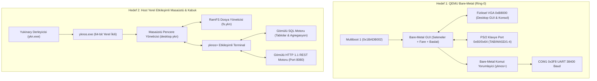

# YknOS: Yukinary Dual-Target Operating System Showcase
# YknOS: Çift Hedefli İşletim Sistemi Gösterimi (Bare-Metal QEMU + Host Native)

[Türkçe](#türkçe-özet) | [English](#english-summary)

---

## Türkçe Özet

**YknOS**, **Yukinary** programlama dili ile geliştirilmiş, harici C, C++ veya Rust çalışma zamanı bağımlılığı bulunmayan hibrit bir işletim sistemi ve masaüstü arayüzü gösterimidir.

YknOS, iki farklı çalışma hedefini (Target) aynı çatı altında birleştirir:

1. **Bare-Metal QEMU Hedefi (Ring-0 Multiboot1 Kernel)**:
   - Doğrudan QEMU sanal makinesinde sıfırdan önyüklenir (altında Windows/Linux yoktur).
   - Gerçek fiziksel `0xB8000` VGA video belleğine grafiksel masaüstü arayüzü (Desktop GUI) çizer.
   - **Sekmeler (Tabs)**: `1: Dosyalar`, `2: SQL`, `3: Ag`, `4: Terminal` arasında anında geçiş.
   - **Başlat Menüsü**: `b` tuşu ile açılan açılır pencere (Dosya Yöneticisi, SQL, Ağ Servisi, Terminal, Kapat).
   - **Gömülü Dosya Yöneticisi (File Manager)**: RamFS sanal dosya sistemindeki dosyaları gezinme (`j`/`k`) ve seçili dosyanın canlı içeriğini önizleme kutusunda okuma.
   - **Hareketli Fare İmleci (Mouse Cursor)**: `w`, `a`, `s`, `d` tuşları ile ekranda serbestçe hareket eden parlak kırmızı/beyaz imleç (`^`) ve canlı X, Y koordinat göstergesi.
   - 16550 UART COM1 (`0x3F8`) donanım seri portu üzerinden terminale çekirdek günlükleri (`dmesg`) akıtır.
   - PS/2 Klavye Denetleyicisi (Port `0x64` ve `0x60`) donanım seviyesinde tuş tarama kodlarını okur. `TAB` tuşuna basarak GUI Arayüz Navigasyon Modu ile Komut Satırı Modu arasında geçiş yapabilirsiniz.

2. **Host Yerel Etkileşimli Kabuk Hedefi (Native Windows / Linux PE & ELF)**:
   - Doğrudan `ykn.exe` ile 64-bit yerel ikiliye dönüştürülür (`yknos.exe`).
   - `masaustu` veya `gui` yazarak interaktif 80x25 masaüstü yöneticisini başlatabilir, sekmeler ve dosya yöneticisi arasında gezinebilirsiniz.
   - Gömülü SQL motoru (`sql hepsi`, `sql filtre`, `sql ozet`, `sql ekle`) ve gömülü HTTP 1.1 JSON ağ yığını (`http durum`, `http sql`, `http sunucu`) ile canlı etkileşime girilmesini sağlar.

---

## Mimari Diyagramı / Architecture Diagram



---

## Nasıl Çalıştırılır? / How to Run

### 1. QEMU Bare-Metal Sanal Makinesinde Başlatma (Masaüstü Arayüzü & Çekirdek)

Bu komut, çekirdeği NASM ile anında derler ve QEMU sanal makine penceresini açar:

```powershell
# PowerShell:
.\examples\yknos\boot_qemu.ps1

# Windows CMD:
examples\yknos\boot_qemu.bat
```

* Açılan mavi renkli QEMU penceresine tıklayarak:
  - `1`, `2`, `3`, `4`: Sekmeler arasında geçiş yapabilirsiniz (1: Dosyalar, 2: SQL, 3: Ağ, 4: Terminal).
  - `b`: Başlat Menüsü penceresini açıp kapatabilirsiniz.
  - `w`, `a`, `s`, `d`: Ekranda fare imlecini (`^`) hareket ettirebilirsiniz.
  - `j`, `k`: Dosya Yöneticisinde dosyalar arasında gezinip canlı önizlemelerini görebilirsiniz.
  - `TAB`: GUI Kontrol Modu ile Terminal Komut Modu arasında geçiş yapabilirsiniz. Komut modundayken `ls`, `cat /sistem.cfg`, `sql`, `http`, `bellek`, `gui`, `kapat` yazabilirsiniz.
* Aynı anda ana terminalinizde COM1 seri portundan akan canlı çekirdek loglarını görebilirsiniz.

### 2. Host Üzerinde Canlı Etkileşimli Masaüstü ve Kabuğu Başlatma

Yukinary ile derlenmiş yerel ikiliyi çalıştırmak için:

```powershell
# PowerShell:
.\examples\yknos\run_demo.ps1

# Windows CMD:
examples\yknos\run_demo.bat
```

Açılan `yknos> ` kabuğunda kullanabileceğiniz komutlar:
- `masaustu` / `gui`: Grafiksel Masaüstü, Sekmeler, Başlat Menüsü ve Dosya Yöneticisini açar
- `dosyalar` / `fm` : RamFS Dosya Yöneticisi sekmesini doğrudan açar
- `yardim`          : Tüm komutların listesi
- `bilgi`           : Çekirdek ve mimari bilgileri
- `ls / dir`        : RamFS bellek içi sanal dosya sistemini listeleme
- `cat <dosya>`     : Dosya içeriğini okuma (`cat /sistem.cfg`, `cat /index.html`, `cat /veritabani.sql`)
- `bellek`          : 64 MB fiziksel RAM ve 4 KB sayfalama durumu
- `gorevler`        : Çalışan süreçler ve PCB zamanlayıcı
- `sql hepsi`       : Gömülü ilişkisel SQL tablosunu listeleme
- `sql ekle`        : Canlı SQL tablosuna yeni çalışma zamanı metriği ekleme
- `http sunucu`     : Gerçek TCP Port 8080 soketini dinleme (Tarayıcınızdan `http://localhost:8080` adresine girip canlı HTML panelini görüntüleyebilirsiniz!)
- `dmesg`           : COM1 seri port dairesel günlük halkasını dökme
- `demo`            : 7 adımlık otomatik sistem tanıtım senaryosu
- `kapat`           : Oturumu sonlandırma

---

## English Summary

**YknOS** is a comprehensive dual-target operating system and desktop environment showcase written in pure **Yukinary**:

1. **Bare-Metal QEMU Kernel**:
   - Boots directly via Multiboot1 (`0x1BADB002`) into 32-bit protected mode.
   - Renders a complete **Graphical Desktop Environment** onto physical VGA `0xB8000` text memory.
   - Features **Tabs** (`1: Files`, `2: SQL`, `3: Network`, `4: Terminal`), a popup **Start Menu** (`b`), an interactive **RamFS File Manager** with live file previews (`j`/`k`), and a movable **Mouse Cursor** (`w`/`a`/`s`/`d`) with real-time coordinate tracking.
   - Supports hardware PS/2 keyboard processing with instant `TAB` toggling between GUI navigation and command-line shell modes.
   - Streams live kernel logs over 16550 UART COM1 serial port (`0x3F8`).
2. **Host Interactive Desktop & Shell**:
   - Compiles directly to native 64-bit executable via `ykn.exe`.
   - Launchable interactive GUI desktop manager via `masaustu` / `gui`.
   - Real TCP/IP socket listener on Port 8080 serving embedded RamFS HTML dashboard.
   - In-memory relational SQL engine with dynamic record inserts and aggregated queries.
