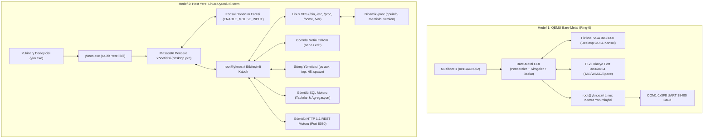

# YknOS: Linux & Windows-Inspired Dual-Target Operating System Showcase
# YknOS: Linux ve Windows Esinlenimli Çift Hedefli Masaüstü İşletim Sistemi (Bare-Metal QEMU + Host Native)

[Türkçe](#türkçe-özet) | [English](#english-summary)

---

## Türkçe Özet

**YknOS**, **Yukinary** programlama dili ile geliştirilmiş, harici C, C++ veya Rust çalışma zamanı bağımlılığı bulunmayan, gerçek bir Linux/Unix çekirdeği ve Windows benzeri grafiksel pencere yöneticisi mimarisine sahip hibrit bir işletim sistemidir.

YknOS, iki farklı çalışma hedefini (Target) aynı çatı altında birleştirir:

1. **Bare-Metal QEMU Hedefi (Ring-0 Multiboot1 Kernel)**:
   - Doğrudan QEMU sanal makinesinde sıfırdan önyüklenir (altında Windows veya Linux ana işletim sistemi yoktur).
   - Gerçek fiziksel `0xB8000` VGA video belleğine grafiksel masaüstü pencere yöneticisi (Desktop GUI) çizer.
   - **Masaüstü Simgeleri (Desktop Icons)**: `[D] VFS Gezgin`, `[N] Editor`, `[T] Gorev Yoneticisi`, `[S] SQL Studio`, `[W] HTTP Ag`, `[C] Kabuk`.
   - **Pencere Modeli (Window Manager)**: Başlık çubuğu `[ _ ][ X ]`, menü çubuğu, araçlar ve durum çubuğu ile gerçek pencereler.
   - **Tıklanabilir Fare İmleci**: `Space` veya `t` tuşu ile ekrandaki simgelere, pencerelere ve butonlara tıklama.
   - 16550 UART COM1 (`0x3F8`) donanım seri portu üzerinden terminale çekirdek günlükleri (`dmesg`) akıtır.
   - PS/2 Klavye Denetleyicisi (Port `0x64` ve `0x60`) donanım seviyesinde tuş tarama kodlarını okur. `TAB` tuşuna basarak GUI Pencere Modu ile `root@yknos:/# ` komut satırı arasında geçiş yapılabilir.

2. **Host Yerel Etkileşimli Kabuk Hedefi (Native Windows / Linux PE & ELF)**:
   - Doğrudan `ykn.exe` ile 64-bit yerel ikiliye dönüştürülür (`yknos.exe`).
   - **Gerçek Donanım Faresi Desteği**: Windows Konsolunda `ENABLE_MOUSE_INPUT` ve `ENABLE_EXTENDED_FLAGS` etkinleştirilerek fiziksel fare hareketleri ve sol/sağ tıklamalar doğrudan masaüstüne aktarılır.
   - Gerçek Linux dosya ağacı hiyerarşisi (`/bin`, `/etc`, `/proc`, `/dev`, `/home/root`, `/var/log`).
   - Dinamik sanal `/proc` dosya sistemi (`cat /proc/cpuinfo`, `cat /proc/meminfo`, `cat /proc/version`, `cat /proc/uptime`).
   - Gerçek metin editörü: `nano <dosya>` veya `edit <dosya>` (Satır satır düzenleme, `:w` kaydetme, `:wq` kaydedip çıkma).
   - Süreç yönetimi: `ps aux`, `top`, `spawn <komut>`, `kill <pid>`.
   - Bellek ve disk raporları: `free -m`, `df -h`.
   - Çekirdek komut seti: `uname -a`, `uptime`, `whoami`, `hostname`, `date`, `pwd`, `cd`, `ls -la`, `mkdir`, `touch`, `rm`, `echo`, `grep`, `wc`, `env`, `export`, `history`.
   - Gömülü SQL motoru (`sql hepsi`, `sql ekle`) ve gömülü HTTP 1.1 JSON ağ yığını (`http durum`, `http sunucu` Port 8080).
   - Grafiksel masaüstü pencere yöneticisi (`masaustu` veya `gui`).

---

## Mimari Diyagramı / Architecture Diagram



---

## Nasıl Çalıştırılır? / How to Run

### 1. QEMU Bare-Metal Sanal Makinesinde Başlatma (Masaüstü Arayüzü & Çekirdek)

Bu komut, çekirdeği NASM ile anında derler ve QEMU sanal makine penceresini açar:

```powershell
# PowerShell:
.\examples\yknos\boot_qemu.ps1

# Windows CMD:
examples\yknos\boot_qemu.bat
```

* Açılan mavi renkli QEMU penceresinde:
  - `w, a, s, d`: Fare imlecini (`^`) ekranda hareket ettirin.
  - `Space` veya `t`: İmlecin altındaki masaüstü simgesine, butonuna veya pencere kapatma `[ X ]` butonuna tıklayın!
  - `1..6`: Doğrudan pencereler arasında geçiş yapın (1: Dosyalar, 2: Not Defteri, 3: Görev Yöneticisi, 4: SQL, 5: Ağ, 6: Terminal).
  - `b`: Başlat Menüsü penceresini açıp kapatın.
  - `x`: Aktif pencereyi kapatın (Masaüstü görünümüne dönün).
  - `TAB`: GUI Modu ile `root@yknos:/# ` komut satırı arasında geçiş yapın. Komut modundayken `uname -a`, `uptime`, `whoami`, `ps aux`, `top`, `free -m`, `cat /proc/cpuinfo`, `cat /etc/os-release`, `gui`, `exit` yazabilirsiniz.
* Aynı anda ana terminalinizde COM1 seri portundan akan canlı çekirdek loglarını görebilirsiniz.

### 2. Host Üzerinde Canlı Masaüstü ve Linux Kabuğunu Başlatma

Yukinary ile derlenmiş yerel ikiliyi çalıştırmak için:

```powershell
# PowerShell:
.\examples\yknos\run_demo.ps1

# Windows CMD:
examples\yknos\run_demo.bat
```

Açılan `root@yknos:/# ` kabuğunda:
- `masaustu` veya `gui`: Masaüstü Pencere Yöneticisini açar. (Konsolunuzda gerçek farenizi hareket ettirip simgelere tıklayabilirsiniz!)
- `uname -a`              : Çekirdek, derleme ve mimari bilgileri
- `uptime`                : Çalışma süresi ve yük ortalamaları
- `whoami`                : Geçerli kullanıcı (`root`)
- `hostname`              : Makine adı (`yknos-box`)
- `pwd`                   : Mevcut çalışma dizini
- `cd <dizin>`            : Dizin değiştirme (`cd /etc`, `cd /home/root`, `cd ..`)
- `ls`, `ls -la`          : İzinler, boyut ve sahiplikle dizin listeleme
- `cat <dosya>`           : Dosya içeriğini okuma (`cat /etc/os-release`, `cat /etc/passwd`, `cat /var/log/dmesg.log`)
- `cat /proc/cpuinfo`     : Canlı üretilen sanal CPU bilgisi
- `cat /proc/meminfo`     : Canlı üretilen sanal bellek bilgisi
- `cat /proc/version`     : Çekirdek sürüm bilgisi
- `nano <dosya>`          : Gerçek metin editörü (satır ekleme, `:w` kaydetme, `:wq` çıkış)
- `touch <dosya>`         : Yeni dosya oluşturma
- `mkdir <dizin>`         : Yeni dizin oluşturma
- `rm <dosya>`            : Dosya silme
- `grep <kelime> <dosya>` : Dosya içinde arama yapma
- `wc <dosya>`            : Satır, kelime ve bayt sayısı hesaplama
- `ps aux`                : Çalışan tüm süreçlerin listesi
- `top`                   : Canlı CPU%, bellek, görev tablosu ve uptime
- `spawn <komut>`         : Yeni arka plan süreci başlatma (PID üretimi)
- `kill <pid>`            : Süreci sonlandırma (SIGKILL)
- `free -m`               : Bellek istatistikleri (Total, Used, Free, Buff/Cache, Available)
- `df -h`                 : Disk ve sanal dosya sistemi kullanım oranları
- `env`                   : Ortam değişkenleri tablosu
- `dmesg`                 : Çekirdek açılış günlükleri
- `history`               : Son çalıştırılan komutlar
- `sql hepsi`             : Gömülü ilişkisel SQL veritabanı sorguları
- `http sunucu`           : Port 8080'de gerçek TCP dinleyicisi başlatma
- `exit` / `shutdown`     : Oturumu sonlandırma

---

## English Summary

**YknOS** is a comprehensive Linux- and Windows-inspired dual-target operating system and desktop environment written in pure **Yukinary**:

1. **Bare-Metal QEMU Kernel**:
   - Boots directly via Multiboot1 (`0x1BADB002`) into 32-bit protected mode.
   - Renders a complete **Graphical Window Manager Desktop** onto physical VGA `0xB8000` text memory with clickable mouse support (`Space` / `t`).
   - Features **Desktop Icons** (`[D] VFS`, `[N] Editor`, `[T] Tasks`, `[S] SQL`, `[W] HTTP`, `[C] Shell`), window titlebars with `[ _ ][ X ]` controls, a popup **Start Menu**, and bottom Taskbar.
   - Hardware PS/2 keyboard processing with instant `TAB` toggling between GUI navigation and `root@yknos:/# ` command line.
   - Streams live kernel logs over 16550 UART COM1 serial port (`0x3F8`).
2. **Host Linux-Compatible Subsystem & Shell**:
   - Compiles directly to native 64-bit executable via `ykn.exe`.
   - **Hardware Mouse Input**: Integrates with Win32 Console API via `ENABLE_MOUSE_INPUT` for real-time cursor tracking and click handling.
   - Hierarchical Linux VFS (`/bin`, `/etc`, `/proc`, `/dev`, `/home/root`, `/var/log`).
   - Dynamic `/proc` pseudo-filesystem (`/proc/cpuinfo`, `/proc/meminfo`, `/proc/version`, `/proc/uptime`).
   - Built-in text editor (`nano <file>` / `edit <file>`) with `:w` save and `:wq` exit.
   - Process subsystem: `ps aux`, `top`, `spawn <cmd>`, `kill <pid>`.
   - Coreutils: `uname -a`, `uptime`, `whoami`, `hostname`, `date`, `pwd`, `cd`, `ls -la`, `mkdir`, `touch`, `rm`, `echo`, `grep`, `wc`, `free -m`, `df -h`, `env`, `history`, `dmesg`.
   - Embedded relational SQL and HTTP 1.1 REST microservice on port 8080.
