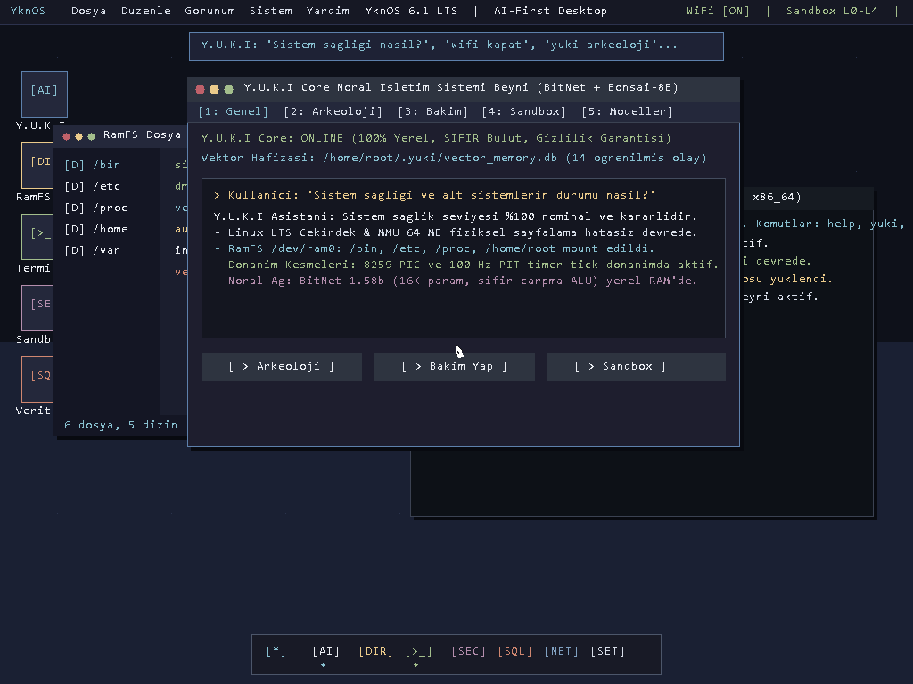

# YknOS: AI-First Operating System & Userspace Architecture
# Linux LTS Kernel + YKN Userspace + Y.U.K.I Core Neural OS Assistant

[Türkçe](#türkçe-özet) | [English](#english-summary) | [Vizyon Belgesi (VISION.md)](VISION.md)

---

## 📸 Canlı Masaüstü Ekran Görüntüleri (1024x768 TrueColor Bare-Metal)



*QEMU Bare-Metal (Ring-0) üzerinde BGA 1024x768x32 TrueColor Framebuffer, PS/2 Donanım Faresi ve Y.U.K.I Core Nöral İşletim Sistemi Arayüzü.*

---

## 🌟 Temel Vizyon & Felsefe (AI-First & Modern GUI)

YknOS, **Yukinary** programlama dili ile geliştirilmiş, harici C/C++ çalışma zamanı bağımlılığı bulunmayan, Linux LTS çekirdeği üzerinde çalışan yerel kullanıcı alanı (YKN Userspace) ve yapay zeka merkezli (**AI-First**) modern bir işletim sistemi mimarisidir.

Arayüz tasarımı **Windows 11, macOS ve modern Linux masaüstü ortamlarının (GNOME/KDE)** en zarif özelliklerini bir araya getirirken, [VISION.md](VISION.md) belgesindeki temel felsefeyi merkezine alır:

- **"Başlangıç Menüsü Yerine AI" (Spotlight AI Bar)**: Geleneksel karmaşık başlat menüleri yerine, ekranın üst merkezinde yer alan akrilik nöral arama barı üzerinden doğal dille işletim sistemi yönetimi.
- **Modern Pencere Yöneticisi (`ykn-wm`)**: macOS tarzı 🔴🟡🟢 pencere kontrolleri, pencereler arası derinlik hissi veren drop shadow gölgelendirmeleri, akrilik koyu tema (`#1E1E2E`) ve yuvarlatılmış paneller.
- **Y.U.K.I Core Nöral İşletim Sistemi Merkezi**:
  - `[1: Genel]`: Canlı telemetri, yerel vektör belleği durumu, doğal dil soru-cevap alanı.
  - `[2: Arkeoloji]`: Çekirdek ve donanım olaylarının timeline kök neden analizi.
  - `[3: Bakım]`: S.M.A.R.T, RamFS, log rotasyonu ve zombi süreç tasfiyesi.
  - `[4: Sandbox]`: 5 seviyeli güvenlik modeli ve izin hiyerarşisi.
  - `[5: Modeller]`: BitNet 1.58b ternary {-1, 0, +1} mikro-LLM ve Bonsai-8B GGUF durumu.
- **RamFS Dosya Gezgini**: Sol gezinme ağacı (`/bin`, `/etc`, `/proc`, `/home`, `/var`) ve sağ dosya ızgarası.
- **yknsh Terminali**: Etkileşimli Linux 6.1 kullanıcı alanı kabuğu (`help`, `yuki`, `uptime`, `date`, `clear` vb.).
- **Yarı Saydam Alt Dock (Floating Acrylic Dock)**: Windows 11 ve macOS Dock tarzı yuvarlatılmış cam kapsül ve aktif uygulama göstergeleri.
- **Gerçek Donanım Faresi (Hardware Mouse)**: PS/2 denetleyicisi üzerinden 3-baytlık streaming veri paketlerini çözen, gölgeli beyaz ok imleci (`12x18 arrow pointer`) ve pikselleri titreşimsiz koruyan dirty-rect arka plan saklama motoru.

---

## 🏛️ 4 Yetenek Katmanı (Capability Layers)

| Katman | Seviye | Açıklama & İşlev |
| :--- | :--- | :--- |
| **Katman 1** | CLI & Tanılama | `yknsh` entegrasyonu, log analizi (`dmesg`, `journalctl`), servis izleme ve komut önerisi/otomatik düzeltme. |
| **Katman 2** | FFI & Güvenlik | C ABI / Syscall wrapper, dosya sistemi olayları (inotify), ağ anomali tespiti ve izin denetimi. |
| **Katman 3** | Proaktif Bakım | Davranış tahmini, disk/kaynak optimizasyonu, periyodik sağlık raporları ve yerel vektör belleği. |
| **Katman 4** | Dürüst Sınırlar | Güvenli fallback, insan onayı gerektiren kritik eylemler, donanım/çekirdek çökmesi sınırları. |

---

## 🛡️ 5 Seviyeli Sandbox Güvenlik Modeli

```
+---------------------------------------------------------------+
|  Seviye 0: Kernel (Linux LTS, Ring-0, Dokunulmaz Çekirdek)    |
|  - Sürücüler, MMU Sayfalama, Ağ Yığını, Sistem Çağrıları      |
+---------------------------------------------------------------+
|  Seviye 1: Y.U.K.I Core (Tam Yetki + Zorunlu Audit Log)       |
|  - Nöral sistem analizi, hata kurtarma, /home/root/.yuki/     |
+---------------------------------------------------------------+
|  Seviye 2: YKN Sistem Servisleri (Capability-Based Yetki)     |
|  - ykn-init (PID 1), ykn-sql-engine, ykn-httpd (Port 8080)   |
+---------------------------------------------------------------+
|  Seviye 3: Kullanıcı Uygulamaları (İzole Sandbox, Açık İzin)  |
|  - Ağ: Varsayılan KAPALI | Dosya: ~/documents/<uygulama>/     |
|  - Kamera / Mikrofon / Donanım: Her kullanımda kullanıcı onayı|
+---------------------------------------------------------------+
|  Seviye 4: LLM Tarafından Üretilen Kod (En Kısıtlı Sandbox)   |
|  - Sıfır sistem erişimi, çalıştırmadan önce çift onay zorunlu |
+---------------------------------------------------------------+
```

---

## 🚀 Çalıştırma Rehberi (How to Run)

### 1. QEMU ile Gerçek Donanım Masaüstünü Başlatma (Tavsiye Edilen):

```powershell
# QEMU Sanal Makinesinde 1024x768 Grafiksel Masaüstü:
.\boot_qemu.ps1

# veya Windows CMD ile:
boot_qemu.bat
```

*QEMU penceresinde tam çözünürlüklü 1024x768 TrueColor grafiksel masaüstü açılır. Ekranda farenizi hareket ettirebilir, pencerelere ve sekmelere tıklayabilir, `1`..`5` tuşlarıyla Y.U.K.I sekmeleri arasında gezinebilir, `TAB` tuşuyla pencereler arasında geçiş yapabilirsiniz.*

### 2. Host Yerel İnteraktif Kabuğu Başlatma:

```powershell
.\build.ps1
.\run_demo.ps1
```

---

## 📁 Proje Dizin Yapısı

```
yknos/
├── boot/
│   ├── font8x14.inc            # 8x14 Consolas Bitmap Font Tablosu (ASCII 32..126)
│   ├── yknos_baremetal.asm     # 1024x768 BGA + PS/2 Mouse & Keyboard Ring-0 Çekirdeği
│   └── boot.asm                # Minimal önyükleyici
├── kernel/                     # Çekirdek yöneticileri (MMU, VFS, Scheduler, Desktop)
├── services/                   # Y.U.K.I Core, AI Motoru (BitNet & Bonsai), SQL, HTTP
├── shell/                      # yknsh komut satırı ve kabuk yorumlayıcısı
├── screenshots/                # Canlı QEMU masaüstü ekran görüntüleri
├── boot_qemu.ps1               # QEMU başlatıcı betik
├── build.ps1                   # Yukinary derleme betiği
└── VISION.md                   # YKNOS Vizyon ve Mimari Belgesi
```

---

## Lisans & Telif Hakkı

Copyright (c) 2026 Berkan Öztürk (nyxsiz0 / ykncode). Tüm hakları saklıdır.  
YknOS mimarisi ve felsefesi [VISION.md](VISION.md) belgesinde detaylandırılmıştır.
