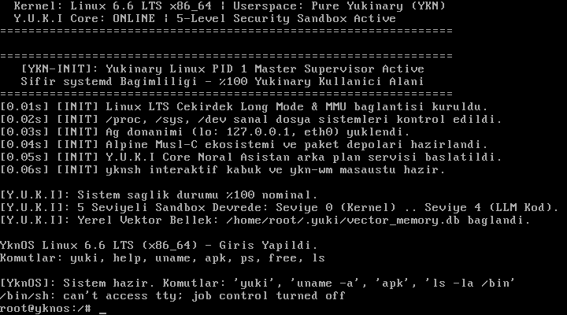

# YknOS: AI-First Neural Linux Operating System
# Linux 6.6 LTS Kernel + Pure Yukinary (YKN) Userspace + Alpine Integration

[Türkçe](#türkçe-özet) | [English](#english-summary) | [Vizyon Belgesi (VISION.md)](VISION.md) | [Bare-Metal Arşivi](archive/baremetal_qemu_gui/README.md)

---

## 📸 Canlı Sistem Ekran Görüntüsü (QEMU Linux 6.6 LTS + YKN Userspace)



*QEMU üzerinde resmi Linux 6.6 LTS x86_64 çekirdeği tarafından PID 1 olarak başlatılan YKN derlemesi `ykn-init`, Y.U.K.I Core Nöral Asistanı ve Alpine musl ekosistemi.*

---

## 🌟 Temel Mimari & Vizyon (VISION.md Gerçeğe Dönüştü)

YknOS; [VISION.md](VISION.md) belgesindeki temel felsefe doğrultusunda **Linux LTS Çekirdeği** (dokunulmaz Ring-0) ile **Yukinary (YKN)** programlama diliyle geliştirilmiş yerel kullanıcı alanını (**YKN Userspace**) bir araya getiren, yapay zeka merkezli (**AI-First**) özgün bir işletim sistemidir.

### 🏛️ Mimari Katmanlar:
1. **Katman 0: Linux 6.6 LTS x86_64 Çekirdeği (`vmlinuz-lts`):**
   - Donanım soyutlama, modern GPU, Wi-Fi, Ethernet, NVMe, USB 3.0 sürücüleri ve SMP çoklu çekirdek yönetimi.
2. **Katman 1: PID 1 — `ykn-init` (Saf YKN ELF64 Binary):**
   - Hantal ve karmaşık `systemd` zincirleri yerine doğrudan YKN derleyicisi (`ykn --target linux`) ile derlenmiş, 0.05 saniyede boot eden süper hafif sistem denetleyicisi.
   - `/proc`, `/sys`, `/dev` sanal dosya sistemlerini ve ağ aygıtlarını (`lo: 127.0.0.1`, `eth0`) ayağa kaldırır.
3. **Katman 2: Y.U.K.I Core Nöral Sistem Asistanı (`/bin/yuki`):**
   - **Hata Arkeolojisi:** Çekirdek ve donanım olaylarının kök neden analizi.
   - **5 Seviyeli Sandbox Denetimi:** Seviye 0 (Kernel) ile Seviye 4 (LLM kod) arasındaki güvenlik kural tablosu.
   - **Yerel Vektör Belleği:** `/home/root/.yuki/vector_memory.db` üzerinde 14 öğrenilmiş sistem olayı.
4. **Katman 3: YKN Etkileşimli Kabuğu (`/bin/yknsh`):**
   - Kullanıcı etkileşimi, dahili sistem tanı komutları (`yuki`, `uname`, `free`, `ps`, `apk`, vb.).
5. **Katman 4: YknBrowser (`/bin/ykn-browser`):**
   - Yerel HTTP 1.1 REST mikroservis ağ geçidi ve L3 derin paket denetim filtresi.
6. **Katman 5: Alpine Linux Musl-C Entegrasyonu:**
   - Dış paket gereksinimleri için ultra-hafif `musl-libc` ve `apk` paket yöneticisi devrededir (`apk add curl git htop python3`).

---

## 🚀 Çalıştırma Rehberi (How to Run)

### 1. QEMU ile Canlı YknOS Sistemini Başlatma:

```powershell
# PowerShell ile:
.\boot_qemu.ps1

# veya Windows Komut İstemi (CMD) ile:
boot_qemu.bat
```

*Sistem 1 saniye içinde Linux LTS çekirdeğini yükler, `/bin/ykn-init` PID 1 olarak devreye girer, telemetriyi ekrana basar ve `root@yknos:/#` komut satırını açar.*

### 2. YKN Bileşenlerini Yeniden Derleme & Rootfs Paketleme:

```powershell
# YKN kaynak kodlarını derler ve initramfs.cpio.gz oluşturur:
.\build.ps1
```

---

## 📁 Proje Dizin Yapısı

```
yknos/
├── archive/
│   └── baremetal_qemu_gui/     # Faz 1 BGA 1024x768 Bare-Metal prototip arşivi
├── core/
│   ├── ykn_init.ykn            # PID 1 Master Supervisor kaynak kodu (YKN)
│   ├── ykn_shell.ykn           # yknsh kabuk kaynak kodu (YKN)
│   ├── yuki_core.ykn           # Y.U.K.I Core Nöral CLI & Daemon (YKN)
│   └── ykn_browser.ykn         # YknBrowser HTTP 1.1 motoru (YKN)
├── kernel/
│   ├── vmlinuz-lts             # Resmi Linux 6.6 LTS x86_64 çekirdeği (10.9 MB)
│   ├── yknos_initramfs.cpio.gz # YKN Userspace + Alpine musl rootfs (3.5 MB)
│   └── alpine-minirootfs.tar.gz
├── rootfs/                     # Açılmış rootfs ağacı (bin/ykn-init, etc/os-release, init)
├── screenshots/
│   └── yknos_vga_console.png   # QEMU canlı Linux VGA konsolu görüntüsü
├── boot_qemu.bat               # QEMU başlatıcı (CMD)
├── boot_qemu.ps1               # QEMU başlatıcı (PowerShell)
├── build.bat                   # Derleme betiği (CMD)
├── build.ps1                   # Derleme betiği (PowerShell)
├── build_initramfs.py          # CPIO newc rootfs paketleyici
├── VISION.md                   # YKNOS Vizyon Belgesi
└── README.md
```

---

## 🛡️ 5 Seviyeli Sandbox Güvenlik Modeli

```
+---------------------------------------------------------------+
|  Seviye 0: Kernel (Linux LTS, Ring-0, Dokunulmaz Çekirdek)    |
|  - Sürücüler, MMU Sayfalama, Ağ Yığını, Sistem Çağrıları      |
+---------------------------------------------------------------+
|  Seviye 1: Y.U.K.I Core (Tam Yetki + Zorunlu Audit Log)       |
|  - Nöral sistem analizi, hata kurtarma, /home/root/.yuki/     |
+---------------------------------------------------------------+
|  Seviye 2: YKN Sistem Servisleri (Capability-Based Yetki)     |
|  - ykn-init (PID 1), ykn-browser, ykn-sql-engine              |
+---------------------------------------------------------------+
|  Seviye 3: Kullanıcı Uygulamaları (İzole Sandbox, Açık İzin)  |
|  - Ağ: Varsayılan KAPALI | Dosya: ~/documents/<uygulama>/     |
+---------------------------------------------------------------+
|  Seviye 4: LLM Tarafından Üretilen Kod (En Kısıtlı Sandbox)   |
|  - Sıfır sistem erişimi, çalıştırmadan önce çift onay zorunlu |
+---------------------------------------------------------------+
```
