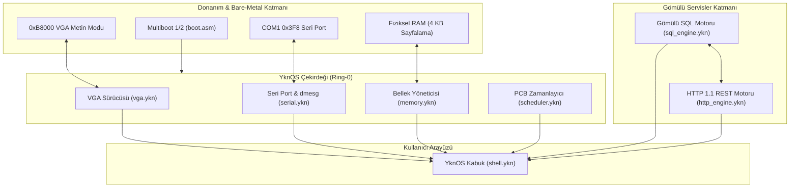

# YknOS: Yukinary Tabanlı Mikro Çekirdek ve İşletim Sistemi Gösterimi
# YknOS: Yukinary-Based Microkernel & Operating System Showcase

[Türkçe](#türkçe-özet) | [English](#english-summary)

---

## Türkçe Özet

**YknOS**, **Yukinary** programlama dili ile sıfırdan geliştirilmiş, harici C, Rust veya C++ çalışma zamanı bağımlılığı bulunmayan deneysel bir çekirdek ve çalışma zamanı ortamıdır.

Bu projenin temel amacı, Yukinary dilinin sistem programlama, doğrudan donanım soyutlama (bare-metal), bellek yönetimi, gömülü ilişkisel veri tabanı motoru ve ağ ayrıştırma yeteneklerini tek bir bütün halinde somutlaştırmaktır.

### Çekirdek Yetenekleri

1. **Önyükleme ve Donanım Temeli (Boot & Low-Level Primitives)**:
   - Multiboot 1 ve Multiboot 2 standartlarına uyumlu önyükleme başlığı (`boot/boot.asm` ve `boot/linker.ld`).
   - 1 MB (`0x00100000`) fiziksel adres hizalaması.
2. **VGA 80x25 Metin Modu Sürücüsü (`kernel/vga.ykn`)**:
   - `0xB8000` video bellek haritalaması, 16 renk paleti, pencere çerçeveleme ve konsol yansıtma.
3. **16550 UART Seri Port Sürücüsü (`kernel/serial.ykn`)**:
   - COM1 (`0x3F8`) I/O portu, 38400 baud iletişimi ve çekirdek içi dairesel günlük halkası (`dmesg`).
4. **Fiziksel Sayfalama ve Bellek Yönetimi (`kernel/memory.ykn`)**:
   - 4 KB sayfa boyutu, 64 MB simüle fiziksel bellek, çerçeve bitmap tahsisi ve yığın izleme.
5. **İşbirlikli Görev Zamanlayıcısı (`kernel/scheduler.ykn`)**:
   - Process Control Block (PCB) yapısı, öncelik düzeyleri (1-10) ve kuantum dilimleri (`ps`).
6. **Gömülü İlişkisel SQL Motoru (`services/sql_engine.ykn`)**:
   - Bellek içi ilişkisel tablo yönetimi (`sistem_metrikleri`, `kullanicilar`).
   - `SELECT *`, `SELECT WHERE cpu >= X`, `COUNT(*)`, `AVG(cpu)` ve `SUM(bellek)` agregasyon sorguları.
7. **Gömülü HTTP 1.1 Web Sunucusu ve Ağ Yığını (`services/http_engine.ykn`)**:
   - HTTP/1.1 durum satırı ve başlık ayrıştırıcısı.
   - REST JSON uç noktaları (`GET /`, `GET /api/v1/durum`, `GET /api/v1/sql`, `GET /api/v1/gorevler`).
   - **Canlı SQL-HTTP Köprüsü**: HTTP istemcilerine SQL sorgu sonuçlarını dinamik JSON dizisi olarak iletme yeteneği.
8. **Etkileşimli Çekirdek Kabuğu (`shell/shell.ykn`)**:
   - `yardim`, `bilgi`, `bellek`, `gorevler`, `sql hepsi`, `sql filtre`, `sql ozet`, `http test`, `vga`, `dmesg`, `demo`.

---

## Mimari Diyagramı / Architecture Diagram



---

## Derleme ve Çalıştırma / Build and Run

### 1. Yerel Çalıştırılabilir Olarak Derleme (Windows / PowerShell)

YknOS, doğrudan ana Yukinary derleyicisi (`ykn.exe`) ile tek komutta yerel 64-bit çalıştırılabilir ikiliye dönüştürülür:

```powershell
# Proje ana dizininden:
.\ykn.exe examples\yknos\yknos_main.ykn examples\yknos\yknos.exe

# Çalıştırmak için:
.\examples\yknos\yknos.exe
```

Veya hazır betiği kullanarak:

```powershell
# PowerShell:
.\examples\yknos\run_demo.ps1

# Windows CMD:
examples\yknos\run_demo.bat
```

### 2. QEMU Bare-Metal Önyükleme (Opsiyonel)

Bare-metal ISO veya ELF çekirdeği üretmek için:

```bash
nasm -f elf32 examples/yknos/boot/boot.asm -o boot.o
# Derleyici tarafından üretilen ELF nesne dosyası ile linker.ld kullanılarak bağlanabilir:
ld -m elf_i386 -T examples/yknos/boot/linker.ld -o yknos.bin boot.o [yknos_obj].o
qemu-system-x86_64 -kernel yknos.bin -serial stdio
```

---

## English Summary

**YknOS** is an experimental monolithic-hybrid microkernel demonstration written entirely in **Yukinary**, requiring zero runtime dependencies on C, Rust, or C++.

It demonstrates the practical applicability of Yukinary for:
- Bare-metal hardware programming (VGA 80x25 text mode buffer, 16550 UART serial COM1).
- Physical memory management (4 KB frame bump allocation, heap metrics).
- Cooperative multitasking via Process Control Blocks (PCB scheduler).
- An **embedded relational SQL engine** operating in-memory with typed schemas, filtered queries (`SELECT WHERE`), and statistical aggregations (`COUNT`, `AVG`, `SUM`).
- An **embedded HTTP 1.1 microservice engine** with a RESTful routing layer and dynamic JSON serialization that streams relational SQL table results over HTTP.
