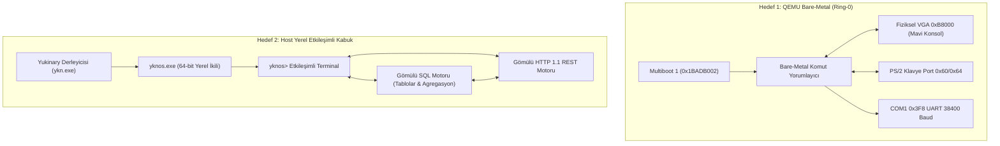

# YknOS: Yukinary Dual-Target Operating System Showcase
# YknOS: Çift Hedefli İşletim Sistemi Gösterimi (Bare-Metal QEMU + Host Native)

[Türkçe](#türkçe-özet) | [English](#english-summary)

---

## Türkçe Özet

**YknOS**, **Yukinary** programlama dili ile geliştirilmiş, harici C, C++ veya Rust çalışma zamanı bağımlılığı bulunmayan hibrit bir işletim sistemi ve çekirdek gösterimidir.

YknOS, iki farklı çalışma hedefini (Target) aynı çatı altında birleştirir:

1. **Bare-Metal QEMU Hedefi (Ring-0 Multiboot1 Kernel)**:
   - Doğrudan QEMU sanal makinesinde sıfırdan önyüklenir (altında Windows/Linux yoktur).
   - Gerçek fiziksel `0xB8000` VGA video belleğine mavi konsol arayüzü çizer.
   - 16550 UART COM1 (`0x3F8`) donanım seri portu üzerinden terminale çekirdek günlükleri (`dmesg`) akıtır.
   - PS/2 Klavye Denetleyicisi (Port `0x64` ve `0x60`) donanım seviyesinde tuş tarama kodlarını (scancode) ASCII'ye dönüştürür.
   - QEMU penceresine tıklayıp klavyenizle doğrudan işletim sistemine komut yazabilirsiniz (`yardim`, `bilgi`, `sql`, `http`, `bellek`, `temizle`, `kapat`).

2. **Host Yerel Etkileşimli Kabuk Hedefi (Native Windows / Linux PE & ELF)**:
   - Doğrudan `ykn.exe` ile 64-bit yerel ikiliye dönüştürülür (`yknos.exe`).
   - Sırayla çıktı basıp kapanmak yerine, canlı `yknos> ` etkileşimli kabuğunu açar.
   - Kullanıcı klavyesinden satır satır komut okur (`GetStdHandle` ve `ReadFile`).
   - Gömülü SQL motoru (`sql hepsi`, `sql filtre`, `sql ozet`, `sql kullanici`) ve gömülü HTTP 1.1 JSON ağ yığını (`http durum`, `http sql`, `http test`) ile canlı etkileşime girilmesini sağlar.

---

## Mimari Diyagramı / Architecture Diagram



---

## Nasıl Çalıştırılır? / How to Run

### 1. QEMU Bare-Metal Sanal Makinesinde Başlatma (Gerçek OS Deneyimi)

Bu komut, çekirdeği NASM ile anında derler ve QEMU sanal makine penceresini açar:

```powershell
# PowerShell:
.\examples\yknos\boot_qemu.ps1

# Windows CMD:
examples\yknos\boot_qemu.bat
```

* Açılan mavi renkli QEMU penceresine tıklayarak fiziksel klavyenizden `yardim`, `bilgi`, `sql`, `http`, `bellek` yazabilir, Enter'a basarak çalıştırabilirsiniz.
* Aynı anda ana terminalinizde COM1 seri portundan akan canlı çekirdek loglarını görebilirsiniz.

### 2. Host Üzerinde Canlı Etkileşimli Kabuğu Başlatma

Yukinary ile derlenmiş yerel ikiliyi çalıştırarak komut satırında test etmek için:

```powershell
# PowerShell:
.\examples\yknos\run_demo.ps1

# Windows CMD:
examples\yknos\run_demo.bat
```

Açılan `yknos> ` kabuğunda kullanabileceğiniz komutlar:
- `yardim` : Tüm komutların listesi
- `bilgi` : Çekirdek ve mimari bilgileri
- `bellek` : 64 MB fiziksel RAM ve 4 KB sayfalama durumu
- `gorevler` : Çalışan süreçler ve PCB zamanlayıcı
- `sql` : Gömülü ilişkisel SQL tablosunu listeleme ve filtreleme
- `http` : Gömülü HTTP 1.1 mikroservisini sorgulama ve JSON çıktıları
- `vga` : 80x25 renkli VGA ekran çerçevesini ekrana yansıtma
- `dmesg` : COM1 seri port dairesel günlük halkasını dökme
- `demo` : 7 adımlık otomatik sistem tanıtım senaryosu
- `kapat` : Oturumu sonlandırma

---

## English Summary

**YknOS** is a dual-target operating system showcase written in **Yukinary**:

1. **Bare-Metal QEMU Kernel**:
   - Boots directly from SeaBIOS via Multiboot1 (`0x1BADB002`) into 32-bit protected mode.
   - Directly manipulates physical `0xB8000` VGA video RAM.
   - Handles real PS/2 keyboard hardware I/O via ports `0x64` and `0x60`.
   - Streams kernel logs over 16550 UART COM1 serial port (`0x3F8`).
   - Interactive shell inside the QEMU window responding to physical keypresses.
2. **Host Interactive Shell**:
   - Compiles to native 64-bit binary via `ykn.exe`.
   - Runs an interactive `yknos> ` command loop using standard console I/O (`ReadFile`).
   - Features embedded relational SQL querying and HTTP 1.1 REST JSON dispatching.
